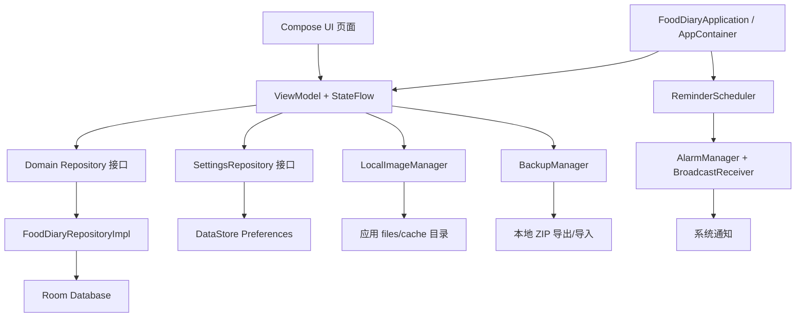
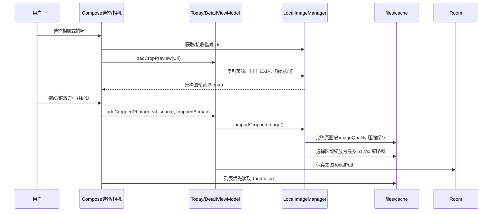

# 饮食体重记录（FoodDiary）项目架构与设计说明

本文档用于帮助新的开发人员理解当前项目，并在现有实现基础上继续修复、升级或增加功能。

文档对应代码状态：

- 应用标识：`com.wkzxmwk.fooddiary`
- 应用显示名称：`饮食体重记录`
- 当前版本：`1.2.0`
- 当前 `versionCode`：`3`
- 最低 Android API：`26`
- 编译方式：Gradle Kotlin DSL
- 数据策略：默认全部保存在手机本地，不使用服务器、登录、广告、支付、云同步或 INTERNET 权限

> 维护原则：优先保持现有分层和职责边界。中小型功能不要引入过重的框架或新的状态管理体系；涉及数据格式的变更必须同时考虑旧数据库、旧备份和旧图片的兼容性。

## 1. 产品范围

应用用于个人饮食照片、早晚体重和体重趋势记录，主要能力包括：

- 今日：按日期记录早餐、午餐、晚餐、加餐照片，以及早晨/晚上体重。
- 历史：按本周、本月、自定义时间区间查看有数据的记录。
- 详情：编辑某天的照片、体重、备注，支持删除当天记录。
- 趋势：最近 7/30/90/120/180 天或全部数据的日平均体重折线图、统计卡片和 BMI。
- 设置：目标体重、身高、性别、图片质量、通知提醒、备份恢复、清除数据、意见反馈和免责声明。

应用不做医疗诊断，不对 BMI 或体重趋势给出医学结论。

## 2. 总体架构

项目采用轻量的分层架构：



### 2.1 分层职责

| 层 | 主要职责 | 当前实现 |
|---|---|---|
| UI | Compose 页面、弹窗、用户交互、加载/空/错误状态 | `ui/**` |
| ViewModel | 页面状态、业务动作、并发控制、错误转换 | 各页面 `*ViewModel.kt` |
| Domain | 纯业务模型、枚举、计算规则、仓储接口 | `domain/**` |
| Data | Room、DataStore、文件、备份、通知调度 | `data/**` |
| App 组装 | 创建数据库、Repository、Manager，并注入页面 | `FoodDiaryApplication.kt`、`FoodDiaryApp.kt` |

当前没有使用 Hilt/Koin。依赖通过 `AppContainer` 手工创建，再由各页面的 `ViewModelFactory` 传入。

## 3. 目录与关键文件

### 3.1 根目录和构建文件

| 文件 | 作用 |
|---|---|
| `settings.gradle.kts` | 声明项目名 `FoodDiary`、模块 `:app` 和依赖仓库 |
| `build.gradle.kts` | 根项目插件版本声明 |
| `app/build.gradle.kts` | Android 模块配置、包名、版本号、SDK、依赖和 Compose/Room/KAPT 配置 |
| `gradle/libs.versions.toml` | Gradle Version Catalog，集中管理插件和依赖版本 |
| `gradle.properties` | Gradle/Android 构建属性 |
| `local.properties` | 本机 SDK 路径，通常不应提交到版本库 |
| `gradlew`、`gradlew.bat` | Gradle Wrapper，Windows 开发优先使用 `.\gradlew.bat` |
| `app/proguard-rules.pro` | Release 混淆规则，目前没有额外业务规则 |
| `app/schemas/` | Room 导出的数据库 schema。活动包名为 `com.wkzxmwk...` 的 schema；旧 `com.example...` schema 是包名迁移历史文件，不是运行时包名 |

当前构建配置重点：

```kotlin
namespace = "com.wkzxmwk.fooddiary"
applicationId = "com.wkzxmwk.fooddiary"
minSdk = 26
targetSdk = 36
versionCode = 3
versionName = "1.2.0"
```

Release 当前 `isMinifyEnabled = false`，尚未在 Gradle 中配置正式签名。发布前应使用发布签名配置生成 AAB/APK，不要把签名文件或密码提交到仓库。

### 3.2 应用入口与依赖组装

| 文件 | 作用 |
|---|---|
| `app/src/main/java/com/wkzxmwk/fooddiary/FoodDiaryApplication.kt` | Application 入口；创建 Room、DataStore Repository、图片管理器、备份管理器和通知调度器；监听设置并同步提醒 |
| `app/src/main/java/com/wkzxmwk/fooddiary/MainActivity.kt` | 单 Activity 入口；启用 Edge-to-Edge 并加载 `FoodDiaryApp()` |
| `app/src/main/java/com/wkzxmwk/fooddiary/ui/FoodDiaryApp.kt` | NavHost、底部导航、各 ViewModelFactory 组装、Android 13 通知权限申请，以及切回“今日”时同步系统日期 |

`FoodDiaryApplication` 是当前唯一的应用级依赖容器。增加新的全局服务时，通常应：

1. 在 `AppContainer` 添加服务字段。
2. 在 `onCreate()` 创建服务。
3. 在需要的 ViewModelFactory 或应用层传入。
4. 如果服务需要设置变化，集中在 Application 层收集 `settingsRepository.settings`。

## 4. Domain 层

### 4.1 数据模型

文件：`domain/model/Models.kt`

#### `DailyRecord`

| 字段 | 类型 | 说明 |
|---|---|---|
| `date` | `LocalDate` | 记录日期，业务层统一使用 `LocalDate` |
| `morningWeight` | `Double?` | 早晨体重，kg，约束 20–300 |
| `eveningWeight` | `Double?` | 晚上体重，kg，约束 20–300 |
| `note` | `String` | 备注 |
| `photos` | `List<MealPhoto>` | 当天所有餐次照片 |
| `createdAt` / `updatedAt` | `Long` | Unix 毫秒时间戳 |

派生属性：

- `averageWeight`：仅早晚体重都存在时计算。
- 公式：`(morningWeight + eveningWeight) / 2`。
- 通过 `WeightCalculator` 四舍五入到一位小数。
- 数据库不存储日平均，避免保存可推导字段。
- `isEmpty` 用于历史页过滤完全没有有效内容的记录。

#### `MealPhoto`

字段包括：

- `id`
- `recordDate: LocalDate`
- `mealType: MealType`
- `localPath: String`：完整主图片路径
- `createdAt`

#### `AppSettings`

DataStore 的领域映射，当前包括：

- `targetWeight: Double?`
- `heightCm: Double?`，有效范围 50–250 cm
- `gender: Gender?`
- `remindersEnabled: Boolean`，默认 `true`
- `notificationPermissionRequested: Boolean`，仅设备权限流程使用，不参与备份
- `breakfastReminderTime`，默认 08:00
- `lunchReminderTime`，默认 12:00
- `dinnerReminderTime`，默认 19:00
- `imageQuality`，默认 80，允许 50–95
- `weightUnit`，当前固定为 `kg`

### 4.2 枚举和业务计算

| 文件 | 作用 |
|---|---|
| `domain/model/MealType.kt` | `BREAKFAST`、`LUNCH`、`DINNER`、`SNACK` 和中文显示名 |
| `domain/model/Gender.kt` | `MALE`、`FEMALE`；也允许设置为 `null` |
| `domain/model/ReminderType.kt` | 三个提醒类型、默认时间、通知文案 |
| `domain/WeightCalculator.kt` | 体重范围、两位小数规范化、日平均计算 |
| `domain/BodyMetricsCalculator.kt` | 身高校验、身高规范化、BMI 保留一位小数 |
| `domain/repository/Repositories.kt` | `FoodDiaryRepository`、`SettingsRepository` 接口，屏蔽底层存储细节 |

BMI 规则：

```text
BMI = 当前体重(kg) / 身高(m)^2
```

趋势页的当前体重优先级是：

1. 最新日期的日平均体重。
2. 若没有日平均，使用最新晚间体重。
3. 若仍没有，使用最新早晨体重。

BMI 没有按性别做额外判断，页面也不显示医疗分类。

## 5. Room 本地数据库

### 5.1 数据库文件

| 文件 | 作用 |
|---|---|
| `data/local/FoodDiaryDatabase.kt` | Room 数据库、数据库版本和 `MealType` TypeConverter |
| `data/local/entity/Entities.kt` | `DailyRecordEntity`、`MealPhotoEntity` |
| `data/local/relation/DailyRecordWithPhotos.kt` | Room `@Relation` 聚合记录和照片 |
| `data/local/dao/DailyRecordDao.kt` | 单日、区间、全部记录的 Flow 查询和删除 |
| `data/local/dao/MealPhotoDao.kt` | 照片增删和按日期查询 |
| `data/repository/FoodDiaryRepositoryImpl.kt` | Entity/Domain 转换、记录自动创建、体重校验和写入 |
| `data/repository/Mappers.kt` | Room Entity 与 Domain Model 映射 |

数据库当前为 `version = 1`，表结构：

```text
daily_records
  dateEpochDay       INTEGER PRIMARY KEY
  morningWeight      REAL NULL
  eveningWeight      REAL NULL
  note               TEXT
  createdAt          INTEGER
  updatedAt          INTEGER

meal_photos
  id                 TEXT PRIMARY KEY
  recordDateEpochDay INTEGER
  mealType           TEXT
  localPath          TEXT
  createdAt          INTEGER
```

`meal_photos.recordDateEpochDay` 外键关联 `daily_records.dateEpochDay`，删除父记录时 Room 级联删除照片记录。图片文件本身不是 Room 管理的，需要由 `LocalImageManager` 手动删除。

### 5.2 Repository 行为

- `updateWeights()` 会自动创建当天空记录，再更新体重。
- `addPhoto()` 会先确保对应日期的 `DailyRecord` 存在。
- `observeRange()` 按日期倒序返回；历史 ViewModel 再过滤完全空记录。
- 日期数据库存储使用 `LocalDate.toEpochDay()`，避免字符串日期排序问题。
- 日平均只在 Domain 层动态计算。

如果增加数据库字段：

1. 修改 Entity/Domain/Mapper/DAO。
2. 提高 `FoodDiaryDatabase.version`。
3. 添加 Room `Migration`，不要依赖破坏性迁移。
4. 重新生成并检查 `app/schemas/`。
5. 增加 Repository/Mapper 测试。

## 6. DataStore 设置

文件：`data/preferences/SettingsRepositoryImpl.kt`

DataStore 名称为 `app_settings`，当前键包括：

```text
target_weight
height_cm
gender
reminders_enabled
notification_permission_requested
breakfast_reminder_time
lunch_reminder_time
dinner_reminder_time
image_quality
weight_unit
```

DataStore 适合保存轻量配置，不要将记录、照片或大对象放入其中。

增加新设置时，应同时修改：

1. `AppSettings`
2. `SettingsRepository`
3. `SettingsRepositoryImpl.Keys`
4. `toSettings()`
5. `SettingsViewModel`
6. `SettingsScreen`
7. `BackupManager`（如果该设置需要随用户备份）
8. 对应单元测试

设备通知权限请求标记 `notificationPermissionRequested` 不写入备份，因为它属于当前设备的系统权限状态。

## 7. 图片存储和生命周期

### 7.1 关键文件

| 文件 | 作用 |
|---|---|
| `data/image/LocalImageManager.kt` | 相机 URI、来源复制、EXIF 旋转、完整原图保存、缩略图保存、删除和分享拼图 |
| `ui/common/ImageInteractions.kt` | 原图预览、拖动/双指缩放、方框选择缩略图区域、点击确认/取消 |
| `ui/common/LocalFileImage.kt` | 优先读取 `.thumb.jpg`，没有缩略图时回退主图；按 maxEdge 采样解码 |
| `res/xml/file_paths.xml` | FileProvider 允许共享的 `cache/camera/` 和 `cache/shared_images/` |

### 7.2 图片文件布局

完整主图保存在：

```text
<context.filesDir>/meal_photos/<yyyy-MM-dd>/<uuid>.jpg
```

同目录缩略图：

```text
<uuid>.thumb.jpg
```

临时目录：

- `cache/camera/`：相机拍摄临时文件
- `cache/image-import/`：选择图片后的来源暂存
- `cache/image-crop-preview/`：裁剪界面的预览解码
- `cache/shared_images/`：今日页分享拼图，超过 24 小时的旧文件会清理

### 7.3 当前图片流程



重要约定：

- 裁剪框只影响缩略图，主文件保留完整原始像素尺寸，再按设置的 JPEG 质量压缩。
- `importCroppedImage()` 是当前拍照/相册的正式入口。
- `importImage()` 是旧的普通导入实现，仍保留但当前 UI 不调用；后续修改图片策略时不要误把它当成主流程。
- 删除照片时同时删除主图和 `.thumb.jpg`。
- 相机临时文件在成功保存、取消或失败后清理。
- 来源读取支持 `openInputStream`、AssetFileDescriptor、FileDescriptor 和 TypedAssetFileDescriptor 多级回退，单个来源限制 50MB。
- 原图完整解码会占用较多内存，超高分辨率设备需要继续关注 OOM 风险。

### 7.4 图片预览

- 今日/历史列表：`LocalFileImage` 默认优先缩略图，降低内存和绘制压力。
- 详情/今日大图：`ZoomableLocalImage` 读取主图，支持双指缩放、拖动、放大和缩小。
- 历史卡片最多展示 4 张照片；点击记录卡片进入详情页。

## 8. 备份和恢复

文件：`data/backup/BackupManager.kt`

备份是用户主动触发的 ZIP，不依赖 Android 系统备份。系统云备份和设备迁移在：

- `res/xml/backup_rules.xml`
- `res/xml/data_extraction_rules.xml`

中明确排除了应用文件、数据库和 SharedPreferences/DataStore 对应区域。

### 8.1 ZIP 内容

```text
backup.json
images/<photoId>.jpg
thumbnails/<photoId>.jpg       # 如果存在
```

`backup.json` 当前版本字段包括：

- `version = 1`
- 导出时间
- `settings`：目标体重、身高、性别、提醒开关、提醒时间、图片质量、单位
- `records`：日期、早晚体重、备注、创建/更新时间、照片元数据

### 8.2 安全和限制

- 只允许 `backup.json`、`images/*.jpg`、`thumbnails/*.jpg` 这类路径。
- 单个 ZIP entry 读取上限约 55MB。
- ZIP 总数据上限 500MB。
- 恢复图片写入新的 generation 目录，数据库事务提交后再替换旧图片目录。
- 导入旧备份时，缺少新增设置字段会使用默认值。

如果需要变更备份 JSON 的必填结构，应提升备份 `version` 或实现向后兼容读取，不能直接破坏旧用户备份。

## 9. 通知提醒

文件：`data/reminder/ReminderScheduler.kt`

功能：

- 早餐：默认 08:00，通知“记得记录早餐和早晨体重”。
- 午餐：默认 12:00，通知“记得记录今天的午餐”。
- 晚餐：默认 19:00，通知“记得记录晚餐和晚上体重”。
- 设置页可总开关和分别修改时间。
- `AlarmManager.setAndAllowWhileIdle()` 安排下一次触发，通知触发后再安排下一天。
- `ReminderRescheduleReceiver` 在开机、应用替换、系统时间变化和时区变化后重新安排。
- Android 13+ 申请 `POST_NOTIFICATIONS`；首次启动只申请一次，设置页可再次申请。
- `RECEIVE_BOOT_COMPLETED` 和 `POST_NOTIFICATIONS` 声明在 `AndroidManifest.xml`。

当前使用非精确闹钟，没有申请 `SCHEDULE_EXACT_ALARM`。不同厂商的省电策略可能造成延迟，不能把提醒当作秒级定时器。

通知渠道：

- ID：`daily_record_reminders`
- 名称：饮食记录提醒
- 重要性：`IMPORTANCE_DEFAULT`

如果新增提醒类型，应同时修改 `ReminderType`、`AppSettings.reminderTime()`、DataStore key、设置页、备份读写、通知文案和默认值测试。

## 10. 页面、导航和状态流

### 10.1 导航

文件：`ui/navigation/AppDestination.kt`

底部导航：

| Route | 中文 | 页面 |
|---|---|---|
| `today` | 今日 | `TodayScreen` |
| `history` | 历史 | `HistoryScreen` |
| `trend` | 趋势 | `TrendScreen` |
| `settings` | 设置 | `SettingsScreen` |
| `record/{epochDay}` | 记录详情 | `RecordDetailScreen` |

详情路由使用 `LocalDate.toEpochDay()` 作为参数，进入页面时再用 `LocalDate.ofEpochDay()` 还原。

### 10.2 今日

文件：

- `ui/today/TodayScreen.kt`
- `ui/today/TodayViewModel.kt`

行为：

- 页面进入“今日”路由时，`FoodDiaryApp` 调用 `todayViewModel.syncToToday()`，日期与系统日期同步。
- 用户仍可在页面内临时切换日期。
- 四种餐次分别显示照片缩略图和添加入口。
- 相册使用 Photo Picker，多选上限 10；相机使用 `ActivityResultContracts.TakePicture`。
- `Mutex` 防止连续确认造成图片重复导入。
- 体重输入校验 20–300kg，支持一/两位小数。
- 顶部分享按钮生成当日 2×2 拼图，通过 FileProvider 调用系统分享面板。
- 分享拼图每餐最多展示 4 张缩略图，主图片和数据库不受影响。

### 10.3 历史

文件：

- `ui/history/HistoryScreen.kt`
- `ui/history/HistoryViewModel.kt`

时间筛选：

- `本周`：当前日期所在周的周一至周日。
- `本月`：当前日期所在月份的第一天至最后一天。
- `自定义`：用户指定起止日期，自动规范先后顺序。

本周/本月切换时以系统当前日期为锚点；左右按钮按周或月移动。历史列表只列出非空记录，卡片点击整个区域进入详情。

### 10.4 详情

文件：

- `ui/detail/RecordDetailScreen.kt`
- `ui/detail/RecordDetailViewModel.kt`

支持：

- 四餐照片添加、查看、删除。
- 早晚体重编辑。
- 备注编辑。
- 删除当天记录前二次确认。
- 删除记录时先删除文件，再删除 Room 记录。

### 10.5 趋势

文件：

- `ui/trend/TrendScreen.kt`
- `ui/trend/TrendViewModel.kt`

范围：

- 7、30、90、120、180 天、全部。
- 固定按系统今天向前计算范围。
- 缺失日期不会补点，图表只绘制有日平均的日期。

图表当前主线是日平均体重，带横纵坐标刻度、网格线和节点。统计卡包括：

- 当前体重
- BMI
- 最近 7 天变化
- 本月平均
- 目标体重
- 记录天数

未来可增加早晨线、晚上线、目标线和移动平均线，推荐扩展 `TrendUiState` 和 `WeightChart` 的数据系列模型，而不是在 Composable 中硬编码第二条线。

### 10.6 设置

文件：

- `ui/settings/SettingsScreen.kt`
- `ui/settings/SettingsViewModel.kt`

包含：

- 目标体重
- 身高
- 性别
- 默认单位 kg
- 图片质量
- 饮食提醒开关和时间
- 导出/导入 ZIP
- 清除全部数据（二次确认）
- 意见反馈邮箱 `148098973@qq.com`
- 关于应用和免责声明

设置 UI 通过 `SettingsViewModel.runWork()` 统一执行异步保存、工作状态和 Snackbar 消息。

## 11. UI 通用组件与主题

| 文件 | 作用 |
|---|---|
| `ui/common/UiComponents.kt` | `SectionCard`、加载状态、空状态等通用组件 |
| `ui/common/LocalFileImage.kt` | 本地图片采样和缩略图优先加载 |
| `ui/common/ImageInteractions.kt` | 裁剪预览、手势缩放、图片查看 |
| `ui/theme/Color.kt` | 健康绿、早晨橙、晚间蓝等颜色 |
| `ui/theme/Theme.kt` | `FoodDiaryTheme` |
| `ui/theme/Type.kt` | 字体排版 |

当前 UI 主要遵循：

- Material 3
- 白色背景、绿色健康主题
- 圆角 SectionCard
- 内容底部导航
- 简体中文
- 触摸区域和图片描述尽量提供无障碍内容描述

## 12. 测试

当前单元测试：

| 文件 | 覆盖内容 |
|---|---|
| `WeightCalculatorTest.kt` | 日平均、体重范围和缺失值 |
| `BodyMetricsCalculatorTest.kt` | BMI、身高范围和缺失值 |
| `ReminderDefaultsTest.kt` | 提醒默认开启及 08:00/12:00/19:00 |
| `FoodDiaryRepositoryImplTest.kt` | 记录自动创建、体重规范化和越界校验 |
| `MappersTest.kt` | Room 日期和 Domain 映射 |

执行：

```powershell
$env:JAVA_HOME = "C:\Program Files\Android\Android Studio\jbr"
.\gradlew.bat testDebugUnitTest assembleDebug
```

仅构建：

```powershell
.\gradlew.bat assembleDebug
```

当前没有完整的仪器测试和 UI 自动化测试。新增重要交互时，建议补充：

- Android 13 通知权限流程。
- 相册/相机 URI 生命周期。
- FileProvider 分享权限。
- Room 数据库迁移。
- 历史周/月/自定义筛选。
- 趋势范围和缺失日期绘图。

## 13. 新功能开发指南

### 13.1 增加一个普通设置

按照顺序修改：

1. `AppSettings`
2. `SettingsRepository`
3. `SettingsRepositoryImpl`
4. `SettingsViewModel`
5. `SettingsScreen`
6. `BackupManager`（需要备份时）
7. 单元测试

### 13.2 增加记录字段

如果是每日记录字段：

1. 修改 `DailyRecordEntity` 和 `DailyRecord`。
2. 修改 `Mappers.kt`。
3. 更新 Room version 和 Migration。
4. 更新详情页、今日页、历史页的 `UiState` 或展示。
5. 更新备份 JSON。
6. 增加旧备份兼容读取。

### 13.3 增加趋势指标

推荐在 `TrendViewModel.calculateState()` 计算业务值，把结果放入 `TrendUiState`，`TrendScreen` 只负责展示。可复用 `WeightCalculator` 或新增纯 Kotlin Calculator，并先写单元测试。

### 13.4 增加图片能力

不要在 UI 里直接复制文件或操作 Room。统一通过：

- `LocalImageManager` 处理来源、压缩、缩略图和删除。
- `TodayViewModel`/`RecordDetailViewModel` 处理并发和 Repository 写入。
- `LocalFileImage` 处理显示采样。

如果需要保存裁剪区域元数据，应新增 Domain/Entity 字段并考虑旧照片没有裁剪信息的回退策略。

### 13.5 增加导航页面

1. 在 `AppDestination` 增加底部导航项，或在 `FoodDiaryApp` 增加非底部路由。
2. 创建 `Screen`、`UiState`、`ViewModel` 和 `ViewModelFactory`。
3. 在 `FoodDiaryApp` 的 `NavHost` 注册。
4. 明确返回栈、底部导航选中状态和日期参数编码。

## 14. 当前已知事项和风险

1. **原图完整解码内存较高**：为了保留原始像素尺寸，确认保存图片时会完整解码后再 JPEG 压缩。超高分辨率图片可能造成较高内存压力，需要后续评估流式/分块方案。
2. **旧照片兼容**：新流程会生成 `.thumb.jpg`；旧照片没有缩略图时会回退读取主图。
3. **删除顺序**：详情删除照片/记录时先删文件后删数据库，若数据库操作失败可能无法自动恢复文件；如需更强一致性，建议引入删除队列或反向补偿。
4. **备份提交边界**：数据库事务提交和 DataStore 设置写入不是同一个事务，导入过程中后半段失败时可能出现数据库已替换、设置未完全更新的状态。
5. **通知不是精确定时器**：AlarmManager 使用省电型非精确调度，厂商电池策略可能延迟通知。
6. **通知权限是系统状态**：Android 13+ 用户拒绝权限后，应用内开关仍可能显示开启，但系统不会显示通知；设置页会提示重新授权。
7. **硬编码中文较多**：当前页面文案主要直接写在 Kotlin 中，若要国际化，应迁移到 `res/values/strings.xml`。
8. **图标是普通 PNG**：当前启动图标为 `drawable-nodpi/ic_app_icon.png`，后续如需更好适配不同启动器，可拆分为 Android Adaptive Icon 的 foreground/background。
9. **发布签名未配置**：当前构建验证主要是 Debug；正式发布需配置签名、检查 AAB、升级安装、通知权限和数据迁移。
10. **系统备份被明确禁用**：用户必须使用设置页的 ZIP 导出功能保存数据，发布说明中应明确这一点。

## 15. 发布前检查清单

- [ ] `applicationId`、`namespace` 和 FileProvider authority 均为 `com.wkzxmwk.fooddiary`。
- [ ] `versionName` 和 `versionCode` 已递增。
- [ ] 执行 `testDebugUnitTest` 和 `assembleDebug`。
- [ ] 配置正式签名并构建 Release AAB。
- [ ] 在已有 1.2.0 数据上安装升级包，确认 Room/DataStore/图片仍可读取。
- [ ] 测试拍照、相册、多图、裁剪、缩略图、大图查看和删除。
- [ ] 测试历史周/月/自定义筛选和详情跳转。
- [ ] 测试趋势各时间范围、缺失日期、BMI 和目标体重。
- [ ] 测试 Android 13+ 通知权限、提醒开关、三个时间和重启恢复。
- [ ] 测试分享拼图在微信、邮件或其他目标应用中的读取权限。
- [ ] 导出 ZIP，清除数据，再导入 ZIP，确认记录、图片、缩略图和设置。
- [ ] 清除全部数据前确认二次确认和文件清理。
- [ ] 检查应用名称、图标、隐私/免责声明文案和反馈邮箱。
- [ ] 确认 APK/AAB 中不包含 INTERNET 权限。

## 16. 常用定位入口

遇到问题时可以按下面顺序定位：

| 问题 | 首先查看 |
|---|---|
| 页面没有刷新 | 对应 ViewModel 的 `StateFlow`、Repository 的 Room Flow |
| 数据没有保存 | `FoodDiaryRepositoryImpl` 或 `SettingsRepositoryImpl` |
| 图片无法显示 | `LocalImageManager`、数据库 `localPath`、`.thumb.jpg` 是否存在、FileProvider |
| 图片构图不对 | `ImageCropDialog` 的手势/方框计算和 `importCroppedImage` |
| 历史列表不对 | `HistoryViewModel.Selection.range()` 和 DAO 日期范围 |
| 趋势数值不对 | `TrendViewModel.calculateState()`、`WeightCalculator` |
| 通知不触发 | POST_NOTIFICATIONS 权限、通知渠道、AlarmManager、厂商省电设置、Receiver Manifest |
| 导入失败 | `BackupManager` 的 ZIP 路径校验、大小限制、JSON version 和图片文件 |
| 发布包无法升级 | `versionCode` 是否递增、applicationId 是否一致、签名是否一致 |

